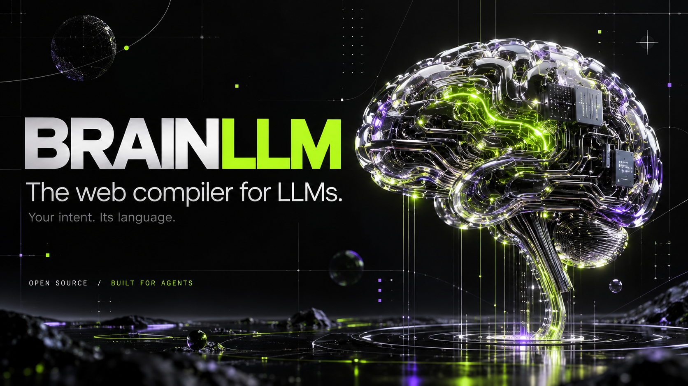
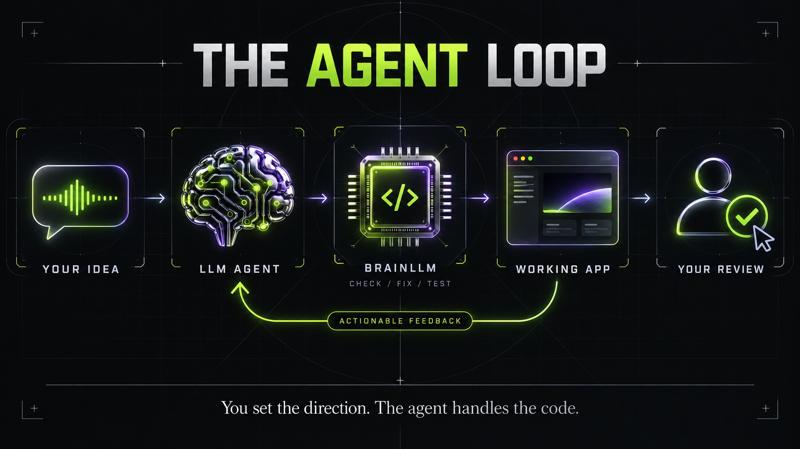
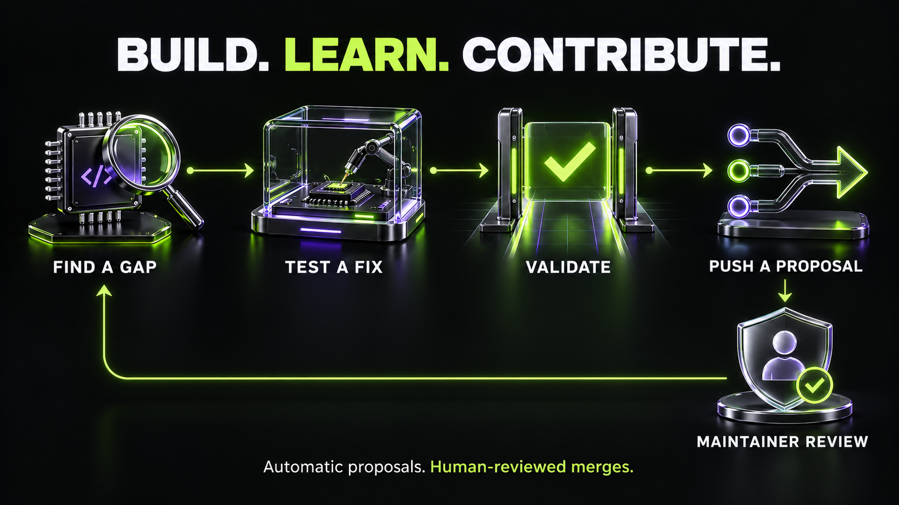

<p align="center"></p>

# BRAINLLM

### 🦀 The web compiler for LLMs, built in Rust. Blazing fast.

**Your LLM owns the frontend. Give it a language built for the job.**

> **Written in Rust, from parser to minifier.** One native binary, no toolchain to install. Warm production builds
> in **~34 ms**, about **4.5× faster than React + Vite** on [our open benchmark](#show-me-the-numbers).

<p align="center">
  
  <a href="https://chrisifm.github.io/BRAINLLM/"></a>
  <a href="https://www.npmjs.com/package/@christianirack/brainllm"></a>
  <a href="LICENSE"></a>
</p>

<p align="center"><a href="https://chrisifm.github.io/BRAINLLM/"></a></p>

<p align="center"><b>🌐 <a href="https://chrisifm.github.io/BRAINLLM/">chrisifm.github.io/BRAINLLM</a></b></p>

BRAINLLM gives coding agents a compact language, a single specification and a native compiler written in Rust that
tells them how to fix mistakes. The model builds the frontend. You set the direction, inspect the result and decide
what ships.

`.brain` components compile to direct-DOM JavaScript and scoped CSS. The Rust toolchain handles parsing, checking,
code generation, bundling and minification. The agent can operate it through the CLI or MCP.

**Build with it. Let your LLM make it better.** Every run is a chance to spot a compiler bug, an expensive step or
a confusing diagnostic. The agent can turn that finding into a tested proposal and, when configured, push it
automatically to a review branch. Maintainers decide what merges.

## Built for agents that change code safely

BRAINLLM is not another React, Next or Node. It is a compiler whose first user is an LLM, and it is designed to
improve itself: when an agent hits a compiler gap, `scripts/evolve.mjs` turns it into an isolated, tested proposal
for human review. The tools other stacks sell as advanced analysis are the baseline here:

- **Locate without reading.** `brain map`, `brain card`, `brain graph`, `brain context` and symbol search give an
  agent the contract and the exact location of what it must touch, never a 2,000-line file.
- **Measured risk before every edit.** `brain risk <target>` returns a deterministic score, the factors behind it
  (dependents, routes, public contracts, backend schema, covering tests, SEO/i18n/a11y, budget headroom) and the
  checks that will prove the edit safe.
- **Atomic changes.** Leased, revision-checked changesets validate the whole app on a private snapshot before
  writing and recover cleanly; a stale revision is rejected instead of overwriting another agent's work.
- **Real-time evidence while developing.** Compiler feedback, impact per save (diagnostics and bytes per view),
  runtime errors mapped to `.brain` lines, memory and leak inspection, over CLI and MCP.

**[Visit the site](https://chrisifm.github.io/BRAINLLM/)** · **[Build your first app](#give-your-agent-its-first-task)** · **[Read the spec](SPEC.md)** · **[See the benchmarks](#show-me-the-numbers)** · **[Contribute](#build-the-tool-your-agent-needs)**

## A frontend language with the model in mind

An agent writing your app needs a contract it can follow and feedback it can act on. BRAINLLM makes that loop
explicit: read the spec, generate a component, check it, apply the fix, test the result.



- **Less to guess.** `brain spec` defines the supported language. One component format, a prescribed project
  structure and generators keep the model working inside a known contract.
- **Feedback it can use.** Diagnostics include the file, location, rule and proposed fix. Mechanical fixes carry
  exact replacement edits; `brain fix` applies them. Decisions that need judgment remain visible to the agent.
- **Tools for the whole loop.** `brain map --json`, `brain check --json`, `brain doctor` and `brain build` let the
  agent inspect, validate and compile its work. `brain mcp` exposes tools over stdio.
- **Output for the browser.** Signals update the affected DOM nodes. The toolchain includes its own compiler,
  bundler and minifier, with no Vite, webpack, esbuild or Babel in the build pipeline.

BrainScript builds on HTML, CSS and a constrained subset of JavaScript. It is designed to reduce the choices an
agent has to reconstruct while preserving code that a developer can read and review.

## What your agent gets to work with

| Capability | What it does for the app-building loop |
|---|---|
| A served language contract | `brain spec` gives the model the implemented syntax and conventions |
| Task playbooks | `brain guide <topic>` (also MCP `brain_guide`): steps, checks, common mistakes and an example per task (views, data, forms, server, SEO, accessibility, WebMCP, tests, i18n, performance) |
| Components and reactive state | `.brain` files combine markup, BrainScript and scoped styles; `sig`, `drv` and `fx` express updates |
| Forms and data | Form validation, HTTP resources and server contracts give common app behavior a documented path |
| Routes and layouts | Views, layouts, loaders and guards put navigation and access checks into the project structure |
| Diagnostics and repairs | JSON diagnostics identify failures; supported mechanical edits can be applied with `brain fix` |
| Context and automation | The project map, focused reads, CLI and MCP tools let an agent inspect and operate the app |
| Verification and delivery | Tests, `brain doctor` and the production build make validation part of the workflow |
| Tested compiler improvements | Isolated proposals, validation gates and optional review-branch pushes let the agent contribute fixes |

Use [SPEC.md](SPEC.md), the served `brain spec` and [EVOLUTION.md](docs/EVOLUTION.md) for exact contracts and limits.

## Where it fits in the frontend stack

These tools occupy different layers. This is a comparison of their roles, not a universal speed ranking. Linked
project documentation describes each tool; the BRAINLLM column explains the choice this project makes.

| Project | Main role | How BRAINLLM approaches that part of the job |
|---|---|---|
| [React](https://react.dev/) | Library for building component-based user interfaces | A dedicated component language, compiler and agent workflow together |
| [Angular](https://angular.dev/overview) | Web application framework with integrated tooling | A constrained language and normative spec built around LLM authorship |
| [Vue](https://vuejs.org/guide/introduction.html) | Progressive framework for declarative, reactive interfaces | Prescribed component syntax and structure with compiler-guided repairs |
| [Astro](https://docs.astro.build/en/concepts/why-astro/) | Web framework focused on content-driven sites and islands | A language and toolchain for agent-authored frontends, with its own rendering contracts |
| [Vite](https://vite.dev/guide/) | Development server and production build tooling | An integrated Rust pipeline for `.brain` applications |
| [webpack](https://webpack.js.org/concepts/) | Module bundler with loaders and plugins | Its own bundler and minifier as part of the compiler pipeline |
| **BRAINLLM** | **Frontend language, compiler, runtime and agent contract** | **The model writes, checks and improves within one documented workflow** |

Other projects also offer AI guidance and tooling. BRAINLLM's emphasis is the authoring contract itself. It does
not run existing React, Angular or Vue components unchanged, and replacing a build tool alone is not a migration.
The numerical comparison below covers only the measured React/Vite and Svelte/Vite fixture builds.

## A form shouldn't need an ecosystem.

Your agent came to build a button. Your stack handed it a committee.

If setup decisions are consuming the session, give the model a toolchain with a defined contract.

BRAINLLM brings component syntax, state, forms, routing and compiler feedback into one documented workflow. Its
Rust toolchain owns the build pipeline, and the browser runtime has no third-party dependencies. Start with the
web behavior you need; give the agent a smaller set of conventions to learn and check.

**Less tooling. More web.**

## Show me the numbers

**Don't trust the headline. Run the benchmark.**

If you like reading raw timings more than launch posts, this part is for you. Inspect the fixture, reproduce the
run and keep the result even when it disagrees with ours.


**Seven stacks. The same dashboard workflow. 140 measured builds.**

| Warm production build | Median, 20 runs | Standard deviation |
|---|---:|---:|
| BRAINLLM | 34.32 ms | 13.23 ms |
| React + Vite | 155.49 ms | 16.71 ms |
| Vue + Vite | 211.76 ms | 53.56 ms |
| Svelte + Vite | 243.53 ms | 56.14 ms |
| Astro + React island | 504.78 ms | 77.45 ms |
| Angular CLI | 1,262.50 ms | 69.03 ms |
| React + webpack | 1,334.54 ms | 560.99 ms |

All seven implementations passed the same nine Chrome interaction checks, including create, search, edit and delete.
These measurements use frozen BRAINLLM source `7889787`, Apple M5 with 24 GiB RAM, Node 26.12.0 and two warmups per
stack. Builds run serially on a shared machine. Variance matters: inspect the raw samples, especially webpack's.
The output strategies differ (including SSR, client rendering and an Astro React island); this comparison measures
production build duration for this fixture, not universal app performance or feature equivalence.

Read the [expanded method, versions, payloads and results](bench/build/expanded.md). The original three-stack
[historical results](bench/build/results/summary.md) remain available unchanged. Use `bench/build/expanded.mjs`
with the documented frozen binary and scratch-directory setup to reproduce this seven-stack run.

**Ask your agent to challenge the result:**

```text
Reproduce BRAINLLM's build benchmark and tell me what the evidence supports.
First inspect bench/build/README.md, bench/build/run.sh, the frozen fixture,
the React/Svelte reference implementations and their pinned dependencies.
Explain the output differences and required tools before running anything.

Run bench/build/run.sh in an isolated workspace using its documented settings.
Keep the compared fixture implementations unchanged. Record the compiler hash,
tool versions, hardware, machine load, warmups and sample count. Preserve the
raw timings and report cold and warm medians in ms, plus the measured HTML,
CSS and JavaScript payload in KiB gzip with every excluded asset identified.

Compare the local results with the checked-in results. Report failures,
limitations and regressions as observed. Do not claim a win unless the actual
numbers support it. Do not upload results or publish anything automatically.
Clean up only the temporary resources this run created.
```

A separate [cache-key microbenchmark](bench/build/results/compiler-cache-lookup.json) measured **43.3× faster key
lookup** after removing an unnecessary parse: 10,000 lookups of a 1,050-byte input. That number measures this
internal operation only. It is not a full-build speedup or a webpack comparison.

The [benchmark report](bench/REPORT.md) also tracks agent-generated apps, browser behavior, payload size and
failure recovery. Historical LLM results describe their frozen model/spec/compiler runs; they do not guarantee
that a new prompt or compiler revision will pass. This project is open to developers and researchers who want to
investigate how language design and compiler feedback affect agent behavior. Bring a hypothesis and a reproducer.

The compiler pipeline is written in Rust. Browser automation drives real Chrome through CDP for interaction and
regression checks. Those checks establish the flows they exercise; they do not imply universal browser or app
compatibility. The repository's recorded LLM evaluations identify the models, tasks and frozen revisions so you can inspect
what each result actually establishes.

## Tools for an agent that finishes the job

| The agent needs to… | The compiler provides… |
|---|---|
| Start with consistent files | Generators for views, components, channels, services, typed APIs, schemas, route guards and server modules |
| Refactor without guessing imports | Checked AST edits for props, component-file rename, move and extraction |
| Inspect what it built | Chrome screenshots, accessibility outlines and explicit visual baseline comparisons |
| Keep routes small | Enforced `viewKB` budgets for emitted JS + CSS + HTML |
| Defer optional UI | Visible, idle or keyboard-accessible interaction loading; async image decoding |
| Fix and verify | `brain doctor --fix` applies mechanical edits before the full quality check |
| Let you try production output | A temporary local `brain preview` server with owned-process cleanup |

Browser tooling and the preview supervisor currently require macOS or Linux. Screenshot baselines need stable browser,
font and app-data inputs. Runtime mount-time/heap budgets remain planned; the compiler rejects those settings rather
than pretending to measure them. See the [implemented contract](SPEC.md) and [tool internals](docs/INTERNALS.md).

## Give your agent its first task

**Connect your coding agent. Tell it what to build. Try the app.**

Open a coding agent with access to your project files and terminal. Give it the prompt below and your product
brief. It can install the compiler, read the language contract and work through the checks. Once the app runs,
try the actual workflow and tell the agent what should change. You stay in charge of the product and what ships.

BRAINLLM's CLI is the starting point; `brain mcp` also connects through clients that support MCP over stdio.
Your agent needs Node 22+ and Chrome for browser-based checks on macOS or Linux. Git and Rust stable are needed
only when building the compiler from source or contributing. It should report missing prerequisites honestly.

**Paste this into your coding agent:**

```text
Build a small task app with BRAINLLM: add, complete and delete tasks,
and save them locally. Follow https://github.com/chrisifm/BRAINLLM
for setup. Run the checks and open the app for me.
```

<details>
<summary>Expanded agent workflow for a custom project</summary>

```text
Build my frontend with BRAINLLM.

Product brief: [describe the app, its users and the first useful workflow].

1. Inspect the workspace and available tools. Preserve existing files and secrets.
   Verify Node 22+ and Chrome for browser checks. Create a separate app with
   npm create @christianirack/brainll@latest my-app. If npm is unavailable,
   follow the source-install instructions in the README. Report missing prerequisites.
2. Enter the generated app. Read its AGENTS.md and run npx brain spec.
   Only use implemented features in the served spec; do not invent APIs.
3. Read npx brain map --json. Generate the needed views and components with brain add.
   Implement the first complete user workflow, including loading, empty, error
   and success states. Add meaningful behavior tests.
4. Run npx brain fix, then npx brain check --json. Resolve remaining diagnostics.
   Run npx brain doctor and npx brain build. Exercise the workflow in the browser.
5. Report actual test results, remaining gaps and how to run the app. Stop
   temporary processes and close only browser resources you created.
   Do not publish or deploy without my instruction.

At each completed workflow, look for a concrete compiler defect or measurable
improvement. Read docs/EVOLUTION.md and docs/AGENT-IDEAS.md in the framework repo.
Reproduce it, add a regression test and propose the smallest compatible fix.
Only use automatic contribution when I have explicitly configured it for an
owned fork or authorized review branch. Never weaken checks or merge automatically.
```

</details>

<details>
<summary>Prefer to install it yourself? Here are the commands.</summary>

Use the public initializer (no npm account required):

```sh
npm create @christianirack/brainll@latest my-app
cd my-app
npm run dev
```

`npm create @christianirack/brainllm@latest my-app` is the canonical spelling with identical behavior.
Inside the generated app, use `npx brain` for CLI commands and `npm run build` for production.
The compiler is prebuilt; Rust is needed only for the source installation below.

```sh
git clone https://github.com/chrisifm/BRAINLLM.git
cd BRAINLLM
cargo install --locked --path crates/brain-cli
brain new my-app
cd my-app
brain run
```

With a source installation, use the installed `brain` commands directly. That workflow does not require
`npm install` in the generated app.

Cargo installs `brain` into its bin directory; make sure that directory is on your `PATH`. Stop the dev server with
Ctrl+C. From the app directory, run `brain doctor` to validate it and `brain build` to create production output.
For an MCP client in an npm-created app, use command `npx` with arguments `["brain", "mcp"]` and the app as its
working directory. New apps include `.mcp.json` for Claude Code and `.cursor/mcp.json` for Cursor, plus
`CLAUDE.md` importing `AGENTS.md`. Install the pinned dependency, restart the client and verify `brain_spec` appears.
Client trust/approval settings still apply; configuration alone does not prove a live connection.

For an existing app, run `brain agent setup` to merge local registrations, or
`claude mcp add --scope project brain -- npx --no-install brain mcp` for Claude Code alone.
`brain agent setup --hooks` also installs optional Claude Code edit-time check feedback, preserving existing hooks.
The hook checks the app after `.brain`, `.jsbrain` and `.cssbrain` edits; it does not run tests or download packages.
Use `brain mcp --profile minimal` for six core tools, or `--profile backend` for resource/job contracts and generators.
With a source installation, change the registration to command `brain` and arguments `["mcp"]`.
Other clients use their own MCP settings. See [the backend/agent contract](docs/BACKEND.md).

</details>

For an existing frontend, start with the [migration workflow](docs/MIGRATION.md). Its read-only planner recognizes
React, Angular, Vue, Svelte, Next and Nuxt projects. Port one tested route or component at a time, preserve its
behavior and keep a rollback path. It is an incremental workflow, not an automatic transpiler.

## The code your agent handles

```html
<meta props="start:num=0 label:str='Clicks'">

<script>
  let n = sig(start)
  let dbl = drv(() => n * 2)
</script>

<button on:click={n++}>{label}: {n} × 2 = {dbl}</button>
```

The compiler handles signal reads and writes. Derived values update when their inputs change. Styles can live in
the same file and are scoped to the component. The [served spec](SPEC.md) defines the supported syntax.

## Readable intent. Lean browser output.

An internal function named `back_to_home` can become a short identifier in production. The exact letter depends
on scope and the other names in the module. Keep meaningful names where the agent reasons about the code; let the
compiler shorten eligible bindings in what the browser receives.

This example comes from the [minifier's scope regression tests](crates/brain-min/src/mangle.rs):

```js
// Before
function outer(longName, other) {
  const total = longName + other.value;
  return total + window.x;
}

// After
function a(a,b){const c=a+b.value;return c+window.x}
```

Property names and external references retain their meaning. Exported bindings and other protected names follow
the minifier's preservation rules. The source stays readable; the production artifact gets smaller identifiers.
That saves output bytes, not automatically the tokens used by an LLM reading source. Reducing agent context cost
is a separate design goal served by the language contract, focused reads and project map; quantify it with a
measured agent workflow before claiming a token saving.

## Errors should give the agent a next move.

BRAINLLM includes protections at several stages of the app loop:

- **Before it ships:** compiler checks cover supported language rules, accessibility and server/client boundaries.
  Private environment values belong on the server; client access is restricted to `PUBLIC_` values.
- **At the form:** schemas define required fields and supported types; server field errors return to the form.
  The application still owns its business rules, authorization and server-side validation.
- **When a component fails:** runtime boundaries capture render and reactive errors, report them and replace the
  affected component with a fallback. A failing event handler reports the error while keeping the component.
  Retry is bounded: three failures within ten seconds remove the retry button.
- **When work runs away:** runtime budgets stop affected components that exceed monitored limits. The production
  build also probes views with simulated timers for unbounded growth. `brain doctor` runs the project's checks,
  tests and diagnostics; failed stages remain visible to the agent.

These are implemented mechanisms, not a promise to catch every bug or repair every failure. The agent still needs
to test the user's workflow. See [runtime behavior in the spec](SPEC.md#errors-at-runtime),
[component boundaries](runtime/brain-guard.js) and [compiler diagnostics](crates/brain-check/).

## Build the tool your agent needs

**Build with it. Let your LLM make it better.**



A failed compilation can become a regression test. A repeated slow step can become a benchmark. A fix made while
building your app can become a contribution that helps the next developer and their agent.

Found a compiler gap while building an app? Turn the smallest reproducible case into a regression test and a
contribution. BRAINLLM includes an [evolution workflow](docs/EVOLUTION.md) for isolated proposals, validated compiler
binaries and reversible activation. Configured automatic pushes go to review branches; merges require the
principal author's review. This is an explicit development workflow, not a compiler that silently rewrites itself
on every build. Read the [agent improvement playbook](docs/AGENT-IDEAS.md) for an opt-in prompt and concrete ideas
to investigate.

Human developers and LLM contributors are welcome. Useful first contributions include reproducible compiler bugs,
behavior-preserving migration examples, clearer diagnostics and performance improvements with before/after data.

1. Read [CONTRIBUTING.md](CONTRIBUTING.md) and the relevant [internals](docs/INTERNALS.md).
2. Make a focused change with a regression test and synthetic sample data.
3. Run `bash scripts/verify.sh`. It builds the CLI and checks Rust, runtime, tooling, diagnostic fixtures, privacy
   and repository language. Verification also requires ripgrep.
4. Open a pull request with the problem, resulting behavior and actual validation evidence.

Changes to what app authors write also require the frozen LLM benchmark workflow described in CONTRIBUTING.
Never include app secrets, private source or customer data in a contribution.

## Know what you are adopting

BRAINLLM is **0.6.0** (see [CHANGELOG.md](CHANGELOG.md)). Start with a small app or an isolated route and test the behavior you need. Features marked
as planned in the source specification are not a supported promise; `brain spec` serves the implemented contract.
Third-party React, Angular and Vue components do not become BRAINLLM components automatically. Benchmark wins in
build time do not imply that every runtime workload is faster.

## Keep building

| You want to… | Start here |
|---|---|
| Give an agent the project context | [llms.txt](llms.txt) |
| Write an app | [SPEC.md](SPEC.md) and `brain spec` |
| Migrate an existing frontend | [Migration guide](docs/MIGRATION.md) |
| Improve the compiler while using it | [Evolution workflow](docs/EVOLUTION.md) and [agent ideas](docs/AGENT-IDEAS.md) |
| Understand the implementation | [Internals](docs/INTERNALS.md) and [crates](crates/) |
| Inspect examples and reproduce measurements | [Examples](examples/) and [benchmarks](bench/) |
| Contribute a change | [Contributor guide](CONTRIBUTING.md) |

Released under the [MIT license](LICENSE).

Created and maintained by **Christian Irack Flores Maldonado**, principal author.
[ingenieria.dev](https://ingenieria.dev) · [irack.mx](https://irack.mx) · [christian@irack.mx](mailto:christian@irack.mx)

<!-- contributors:start -->
## Built by contributors

Every merged contribution helps the next developer and their agent. Thank you to the public GitHub accounts credited below.

[](https://github.com/chrisifm) [chrisifm](https://github.com/chrisifm)

Attribution is refreshed through a reviewed pull request. [How it works](docs/CONTRIBUTORS.md).
<!-- contributors:end -->
